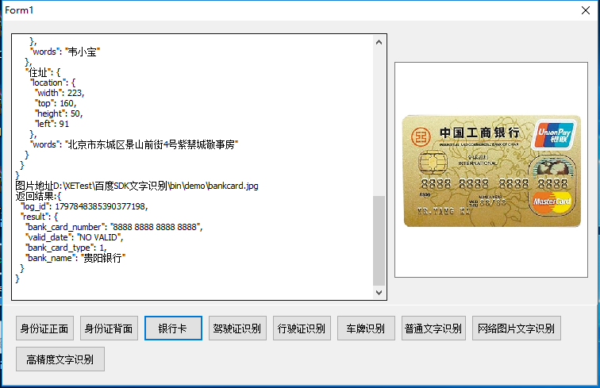
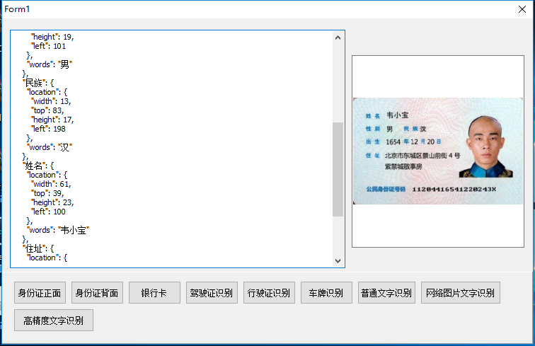

# 百度文字识别（Baidu-AIP-OCR）
主要基于百度文字识别 SDK（C#）做了二次封装，生成 COM，供 Delphi 调用。演示窗口界面文案为简体中文。

1、Windows 系统必须安装 Microsoft .NET Framework 4.5  
2、封装了身份证正面、身份证反面、银行卡、驾驶证、行驶证、车牌识别、普通文字识别、网络图片文字识别和高精度识别。
如需查看百度图片识别 C# SDK 文档，请访问：http://ai.baidu.com/docs#/OCR-Csharp-SDK/top

3、将 `BaiduOCR.tlb` 加入到 Delphi 中：组件 → 导入组件 → 导入类型库，会生成 `BaiduOCR_TLB.Pas`

4、将 `BaiduOCR_TLB` 引入到项目中

5、调用接口函数

function GetBaiduOCRInf: Baidu_OcrInf;
var
 Baidu_OcrImp: _Baidu_OcrImp;
begin
  if not Assigned(Baidu_OcrImp) then
  begin
    Baidu_OcrImp:= CoBaidu_OcrImp.Create;
  end;
  Result:= (Baidu_OcrImp as Baidu_OcrInf);
end;

 6、百度 的key 和 SECRET_KEY 赋值    
 //请输入baidu API_KEY  必填项目
 
  GetBaiduOCRInf.Api_KEY:= 'baidu API_KEY';
  
   //请输入baidu SECRET_KEY 必填项目
   
  GetBaiduOCRInf.SECRET_KEY:= 'baidu SECRET_KEY';
  
7、调用 `BaiduOCR_TLB` 中的函数

本地预览：
- Delphi 演示：用 Delphi 打开 `source/Baidu_IDCard.dproj`，配置 `Api_KEY` / `SECRET_KEY` 后运行，窗口标题为「百度文字识别演示」
- PHP 演示：在 Web 服务器中打开 `demo/DemoAipOcr.php`（需可用的 `AipOcr.php` 与密钥）

